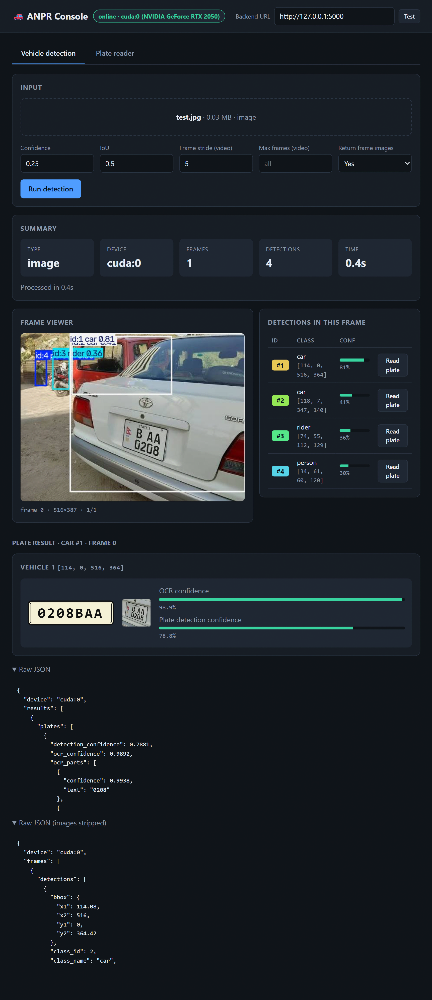

# 🚗 ANPR Backend: Vehicle Tracking & License Plate Recognition

A Flask REST API that detects and tracks vehicles in images or videos, then reads their license plates. It combines two custom-trained **YOLO** models with **EasyOCR**, and runs on the **GPU automatically when one is available**, falling back to the CPU otherwise.

<p align="center">
  
  <br>
  <em>Example output: vehicles are detected and tracked, then the plate of each vehicle is located and read.</em>
</p>

---

## ✨ Features

- **Vehicle detection** on images and videos using a custom YOLO model (`vehicle_best.pt`)
- **Multi-object tracking**: every vehicle keeps a **unique ID across frames** (ByteTrack / BoT-SORT)
- **Per-frame output**: bounding boxes, class, confidence, track ID, timestamp and an annotated frame image
- **License plate detection** inside a vehicle's bounding box using a second YOLO model (`plate_best.pt`)
- **Plate text recognition** with EasyOCR, including preprocessing and support for two-line plates
- **Automatic GPU/CPU switching**: no configuration needed
- **Built-in web UI** for testing both APIs from the browser

---

## 🧠 How it works

```
 image / video
      │
      ▼
┌─────────────────────┐   boxes, classes, confidence,
│  POST /vehicle/detect│──► track IDs, annotated frames
│  YOLO + tracker      │
└─────────────────────┘
      │  choose a vehicle (frame + bbox)
      ▼
┌─────────────────────┐   plate text, OCR confidence,
│  POST /plate/detect  │──► plate bbox, plate crop
│  crop → YOLO → OCR   │
└─────────────────────┘
```

1. **`/vehicle/detect`** runs the vehicle model with tracking, so the same car keeps the same ID from frame to frame.
2. **`/plate/detect`** takes the original image and a vehicle's bbox, crops the vehicle, finds the plate inside it with the plate model, then reads the characters with EasyOCR.

The two endpoints are independent, so you can call them separately or chain them as in the example above.

---

## 📁 Project structure

```
.
├── app.py               # Flask server, helpers and both APIs
├── requirements.txt     # Python dependencies
├── BACKEND_GUIDE.md     # Detailed internals and function reference
├── test.png             # Example output shown above
├── vehicle_best.pt      # YOLO vehicle model   (you provide)
├── plate_best.pt        # YOLO plate model     (you provide)
└── static/
    └── index.html       # Test frontend, served at "/"
```

> **Note:** the `.pt` model files are not included in this repository. Place your trained weights in the project root, or point to them with environment variables (see [Configuration](#-configuration)).

---

## 🚀 Getting started

### 1. Clone and install

```bash
git clone <your-repo-url>
cd <your-repo-name>

python -m venv venv
source venv/bin/activate        # Windows: venv\Scripts\activate

pip install -r requirements.txt
```

**GPU users (NVIDIA):** install the CUDA build of PyTorch first, as the default pip build may be CPU-only:

```bash
pip install torch torchvision --index-url https://download.pytorch.org/whl/cu121
pip install -r requirements.txt
```

### 2. Add your models

Copy `vehicle_best.pt` and `plate_best.pt` into the project root.

### 3. Run

```bash
python app.py
```

The server starts on **http://localhost:5000**. Open it in a browser to use the built-in test UI, or check `GET /health` to confirm which device is in use:

```json
{ "status": "ok", "device": "cuda:0", "gpu_name": "NVIDIA GeForce RTX 3060", ... }
```

> The first run may take a moment as EasyOCR downloads its recognition weights.

---

## 📡 API reference

### `POST /vehicle/detect`

Detect and track vehicles in an image or video.

**Request:** `multipart/form-data`

| Field | Default | Description |
|---|---|---|
| `file` | *required* | Image or video file |
| `conf` | `0.25` | Minimum detection confidence |
| `iou` | `0.5` | NMS IoU threshold |
| `frame_stride` | `1` | Process every Nth frame of a video |
| `max_frames` | – | Stop after N processed frames |
| `include_images` | `true` | Return annotated frames as base64 JPEG |
| `only_tracked` | `false` | Drop detections without a track ID |
| `jpg_quality` | `85` | JPEG quality of returned frames |

```bash
curl -F "file=@traffic.mp4" -F "frame_stride=5" http://localhost:5000/vehicle/detect
```

**Response (abridged):**

```json
{
  "type": "video",
  "device": "cuda:0",
  "fps": 30.0,
  "total_frames": 180,
  "unique_vehicles": 12,
  "unique_vehicles_by_class": { "car": 9, "truck": 2, "bus": 1 },
  "frames": [
    {
      "frame_index": 0,
      "timestamp_sec": 0.0,
      "width": 1920,
      "height": 1080,
      "detections": [
        {
          "track_id": 1,
          "class_id": 2,
          "class_name": "car",
          "confidence": 0.91,
          "bbox": { "x1": 120.5, "y1": 80.2, "x2": 640.0, "y2": 420.7 }
        }
      ],
      "image_base64": "<annotated JPEG>"
    }
  ]
}
```

---

### `POST /plate/detect`

Find and read the license plate of a vehicle.

**Request:** `multipart/form-data` (or JSON with `image_base64`)

| Field | Default | Description |
|---|---|---|
| `image` | *required* | The full frame / image |
| `bbox` | whole image | Vehicle bbox `[x1,y1,x2,y2]`, or a list of boxes, in the coordinates of the supplied image |
| `conf` | `0.25` | Plate detection threshold |
| `pad` | `0.05` | Padding around the plate crop before OCR |
| `include_images` | `false` | Return the plate crop as base64 |

```bash
curl -F "image=@test.png" -F "bbox=[120,80,640,420]" http://localhost:5000/plate/detect
```

**Response:**

```json
{
  "device": "cuda:0",
  "results": [
    {
      "vehicle_bbox": { "x1": 120, "y1": 80, "x2": 640, "y2": 420 },
      "plates": [
        {
          "plate_text": "MH12AB1234",
          "ocr_confidence": 0.87,
          "detection_confidence": 0.93,
          "plate_bbox": { "x1": 300.1, "y1": 360.4, "x2": 460.9, "y2": 410.2 },
          "ocr_parts": [{ "text": "MH12AB1234", "confidence": 0.87 }]
        }
      ]
    }
  ]
}
```

If no plate is found, `plates` is an empty list.

---

### `GET /health`

Returns the server status, active device (`cpu` / `cuda:0`), GPU name and loaded model paths.

---

## 🖥️ Web UI

Opening `http://localhost:5000` gives you a test console with two tabs:

- **Vehicle detection**: upload an image or video, browse annotated frames with a slider, and see a table of tracked vehicles. Click **Read plate** on any detection to run the plate API on it.
- **Plate reader**: upload an image, optionally enter a vehicle bbox, and see the plate text with the vehicle and plate boxes drawn on the image.

---

## ⚙️ Configuration

Set these as environment variables:

| Variable | Default | Description |
|---|---|---|
| `VEHICLE_MODEL_PATH` | `vehicle_best.pt` | Path to the vehicle model |
| `PLATE_MODEL_PATH` | `plate_best.pt` | Path to the plate model |
| `TRACKER_CFG` | `bytetrack.yaml` | Tracker config (`bytetrack.yaml` or `botsort.yaml`) |
| `OCR_LANGS` | `en` | EasyOCR languages, comma-separated |
| `MAX_UPLOAD_MB` | `500` | Maximum upload size |
| `PORT` | `5000` | Server port |

```bash
VEHICLE_MODEL_PATH=/models/vehicle.pt PLATE_MODEL_PATH=/models/plate.pt PORT=8000 python app.py
```

By default OCR only outputs the characters `A-Z` and `0-9`. Edit `OCR_ALLOWLIST` in `app.py` to support other character sets.

---

## 💡 Tips

- **Send the original frame to `/plate/detect`**, not the annotated one. The boxes drawn on the annotated image can reduce OCR accuracy.
- **Large videos produce large responses.** Use `frame_stride`, `max_frames` or `include_images=false` to keep them small.
- **Requests are processed one at a time per model.** For more throughput, run several workers, e.g. `gunicorn -w 2 -b 0.0.0.0:5000 app:app`. Each worker loads its own copy of the models.
- **Deploying publicly?** CORS currently allows any origin and there is no authentication. Restrict CORS, add auth and run behind a reverse proxy first.

For a deeper look at the code, see [BACKEND_GUIDE.md](BACKEND_GUIDE.md).

---

## 🧰 Built with

[Flask](https://flask.palletsprojects.com/) · [Ultralytics YOLO](https://docs.ultralytics.com/) · [EasyOCR](https://github.com/JaidedAI/EasyOCR) · [PyTorch](https://pytorch.org/) · [OpenCV](https://opencv.org/)

## 📄 License

Add your license here (e.g. MIT). Note that Ultralytics YOLO is released under AGPL-3.0, so check its terms for your use case.
